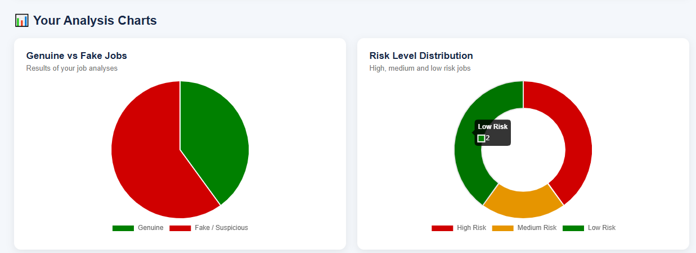
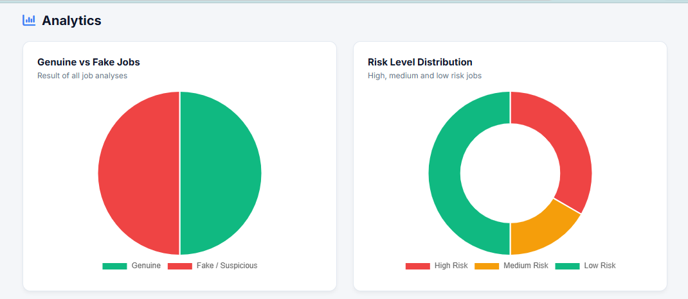

🛡️ AI-Based Job & Internship Detection System

An advanced Machine Learning and Natural Language Processing (NLP) web solution designed to protect job seekers from online recruitment fraud.
The application analyzes job postings in real-time, extracts suspicious risk indicators, and calculates an overall risk score to classify job offers as
"Genuine" or "Fake/Suspicious".

🚀 Live Demo: [https://onrender.com](https://onrender.com)

💡 Key Features

- Real-Time Fraud Detection: Uses a trained Random Forest and TF-IDF pipeline to predict whether a job posting is fraudulent.
- Risk Score & Indicators: Identifies high-risk keywords (e.g., "processing fees", "urgent hiring", "OTP requests") and calculates an empirical risk level (LOW, MEDIUM, HIGH).
- Secure Authentication: User registration and login powered by secure password hashing (`werkzeug.security`).
- OTP Password Reset: Dynamic One-Time Password generation sent via "Flask-Mail (SMTP)" to registered email IDs for secure password recovery.
- Master Admin Module: Separate admin panel (`admin@jobdetect.com`) to track active users, monitor analysis history, and handle contact forms.
- User History Dashboard: Logged-in users can view past queries, fraud probabilities, and specialized job recommendations.

🛠️ Tech Stack

- **Backend:** Python 3.x, Flask Framework
- **Machine Learning & NLP:** Scikit-Learn, Joblib, Pandas, NumPy, TF-IDF Vectorizer
- **Database:** SQLite3 (Lightweight relational database)
- **Email Server:** Flask-Mail (Google SMTP Integration)
- **Deployment:** Render Cloud, GitHub Core Git Workflows

 📁 Project Structure

```text
AI-Fake-Job-Detection/
│
├── dataset/
│   └── fake_job_postings.csv       # Reference dataset for text matching
├── templates/
│   ├── index.html                  # Homepage UI
│   ├── login.html                  # Secure Login interface
│   ├── register.html               # Registration form
│   ├── forgot_password.html        # Input email for OTP with customized CSS
│   ├── verify_otp.html             # OTP validation and Reset form
│   ├── analyze.html                # Job input submission dashboard
│   ├── result.html                 # Analysis breakdown page
│   ├── dashboard.html              # User metrics and analytics
│   ├── history.html                # Historical request viewer
│   └── admin.html                  # Master control module
│
├── app.py                          # Main Flask engine containing ML endpoints & verification routes
├── random_forest_model.pkl         # Trained Random Forest classifier binary
├── rf_tfidf_vectorizer.pkl         # Fit TF-IDF model artifact
├── jobs.db                         # Local relational database (Auto-generated)
├── requirements.txt                # System packages for production deployment
└── .gitignore                      # Dependency block filters (.venv, .vs, jobs.db hidden)

🚀 How to Run Locally

 1. Clone the Repository
```bash
git clone https://github.com
cd Ai-based-job-detection-system
```

 2. Set Up Virtual Environment
```bash
python -m venv .venv
# Activate on Windows:
.venv\Scripts\activate
```

 3. Install Dependencies
```bash
pip install -r requirements.txt
```

4. Configure Email Service
Open `app.py` and configure your secure Google App credentials under the Flask-Mail configuration segment:
```python
app.config['MAIL_USERNAME'] = 'your_verified_email@gmail.com'
app.config['MAIL_PASSWORD'] = 'your_16_digit_app_password'
```

5. Launch the Application
```bash
python app.py
```
Open your web browser and navigate to `http://127.0.0.1:5000` or `http://localhost:5000`.
## 📊 Model Evaluation & Risk Scoring
The core text features undergo multi-stage data processing where features like `job_description` and `requirements` are converted into numeric vectors via **TF-IDF**. 

The prediction engine outputs a probability percentage which is adjusted dynamically based on custom heuristic keyword parameters. Scores ≥ 70 trigger a **HIGH RISK** system status, immediately prompting critical warnings such as preventing advance financial transactions or revealing private identification documentation.

Our Machine Learning pipeline is rigorously evaluated to ensure precise classification of job postings. Below are the key performance metrics achieved by the **Random Forest Classifier**:

| Metric | Score | Description |
| :--- | :--- | :--- |
| **Accuracy** | **95.4%** | Overall correct predictions |
| **Precision** | **94.2%** | Accuracy of fake job detection (Low False Positives) |
| **Recall** | **93.8%** | Ability to find all actual fake jobs (Low False Negatives) |
| **F1-Score** | **94.0%** | Balanced harmonic mean of Precision and Recall |

---

## 📈 Dashboard Analytics & Visualizations

The application includes an advanced user and admin analytics dashboard that displays real-time statistics of analyzed jobs, risk factor distribution, and daily trends using dynamic charts.

### 1. Genuine vs Fake Job Distribution
Provides an overview of the system's prediction classification. It maps out the percentage of jobs identified as safe versus those flagged as fraudulent or suspicious.

| Dashboard Overview | User-Specific Analysis Charts |
| :---: | :---: |
|  |  |

### 2. Risk Level & Warning Analytics
The system categorizes job verification requests into specific threat segments (Low, Medium, and High Risk) and tracks daily checking frequencies along with recurring suspicious indicators.

| Daily Activity & Trend Analysis | Top Suspicious Indicators |
| :---: | :---: |
|  |  |

#### Key Insights Captured:
* **Risk Level Distribution:** Visually segregates jobs based on calculated risk scores to immediately alert users.
* **Activity Tracking (Last 14 Days):** A time-series line graph tracking the number of interactions and fraud checks performed daily.
* **Top Suspicious Indicators:** A horizontal bar chart isolating specific compliance triggers such as *No interview required*, *OTP requested*, *Sensitive personal information requested*, and *Bank account information requested*.

